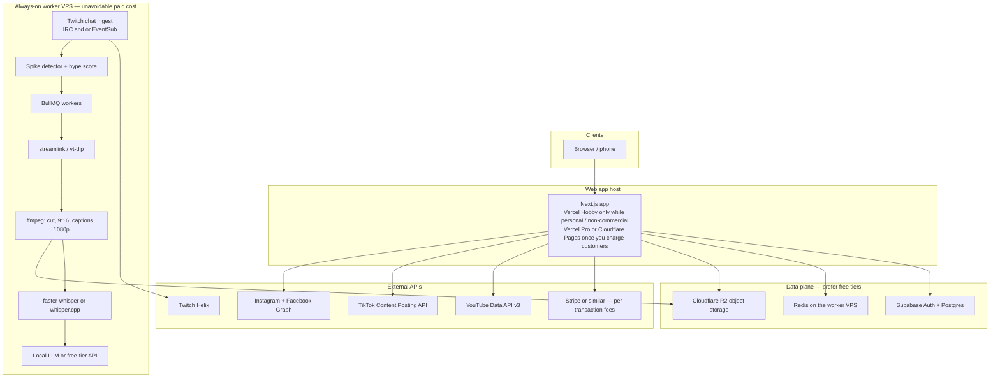

# GTA 6 Clipper — Project Plan

**Status:** planning document for an original product  
**Last updated:** 23 November 2026 (Europe/Stockholm)  
**Working name:** GTA 6 Clipper  
**Assumption for estimates:** one experienced full-stack engineer working full-time, with occasional help on video or model tuning. All phase durations are rough calendar-week estimates, not commitments.

This plan describes how to build a live-stream clipping product for Grand Theft Auto 6 content. It is an original design. It is **not** affiliated with Rockstar Games, Take-Two Interactive, or any existing clipping service. Grand Theft Auto and GTA are trademarks of their owners. Stream footage belongs to the streamers who produce it.

Do not copy another product's source, branding, name, or assets when implementing this plan.

---

## 1. Goals and scope

### Goal

Help a clipper (a streamer, a permitted clipper, or a small agency) turn the moments when a live GTA 6 chat "spikes" into vertical 9:16 Shorts that are ready to review, download, and — on the top plan — auto-post.

### In scope (full feature set)

The product should reach feature parity with a complete clipping desk, not a cut-down first version that drops platforms or core tools:

- **Live Radar:** list every live GTA 6 stream on Twitch, ranked by viewer count and a live chat-hype score.
- **Multi-stream clipping:** watch and clip up to **10 streams at once** (plan-gated: 2 / 5 / 10).
- **YouTube import:** paste a long-form video or VOD of up to **6 hours** and return the best moments as Shorts (plan-gated duration and monthly caps).
- **Chat spike detection:** score laughs, "CLIP IT" (and close variants), emote floods, and sudden message-rate jumps. Each candidate moment gets a hype score.
- **Auto-edit:** cut a window around the spike, reframe to 9:16 with a crop that follows the action, burn in AI captions, export **1080×1920** with **no watermark**.
- **AI captions:** multiple caption styles (4 on Starter, 8 plus brand colours on higher plans).
- **AI titles and hashtags:** generated per destination platform (Pro and Studio).
- **Clip Queue:** review, edit captions or titles, approve or reject, then download.
- **Auto-post (Studio):** publish approved clips to **TikTok, YouTube Shorts, Instagram Reels, and Facebook**, with up to 3 linked accounts per platform, plus scheduling.
- **Auth, billing, and teams:** sign-in, Starter / Pro / Studio subscriptions, Studio seats.

Kick, YouTube Live directory support, and third-party cloud-drive sync (Google Drive, Dropbox, OneDrive) can follow launch; the core storage path is object storage plus download.

### Out of scope for v1

- Building a general-purpose editor for arbitrary non-GTA games (the pipeline should stay game-agnostic under the hood, but the Radar and copy are GTA 6 first).
- Guaranteeing monetization for customers' channels (YouTube Partner Program and similar programs have their own reused-content and copyright rules).
- Scraping or bypassing platform login walls, DRM, or private VODs.
- Running ffmpeg, Whisper, or long-lived stream capture on Vercel serverless functions.

### Non-goals

- Redeploying or forking another vendor's app as a competing service.
- Clipping a stream or video without a recorded permission confirmation from the operator.

---

## 2. Pricing and tiers

The paid shape that fits this product is a three-tier SaaS, priced to cover always-on media infrastructure while staying comparable to adjacent clipping tools.

| | **Starter** | **Pro** | **Studio** |
|---|---|---|---|
| Monthly | **$49**/mo | **$99**/mo | **$199**/mo |
| Yearly (optional, ~20% off) | $39/mo billed annually | $79/mo billed annually | $159/mo billed annually |
| Live streams clipped at once | 2 | 5 | 10 |
| YouTube imports / month | 20 (up to 2h each) | 60 (up to 4h each) | 200 (up to 6h each) |
| Clips / month | 200 | 600 | 2,000 |
| AI caption styles | 4 | 8 + brand colours | 8 + brand colours |
| AI titles and hashtags | — | Yes | Yes |
| 1080p download, no watermark | Yes | Yes | Yes |
| Auto-post to TikTok, YouTube Shorts, Instagram Reels, Facebook | — | — | Yes |
| Linked accounts per platform | — | — | 3 |
| Scheduling | — | — | Yes |
| Team seats | 1 | 1 | 3 |

Every plan includes the Live Radar and a 7-day money-back window on the first payment (policy to be written before launch). Clip and import caps exist as much to protect worker cost as to differentiate plans.

**Important:** do not put a paid checkout on Vercel Hobby. See [Section 12. Costs](#12-costs).

---

## 3. Destination platforms — all four, sequenced by API approval

The product targets **all four** short-form destinations from the start of planning: TikTok, YouTube Shorts, Instagram Reels, and Facebook. Studio auto-posts to all four once each platform's official posting API is approved and wired. Manual download is available on every plan so customers can post by hand on day one, even while an API review is pending.

API approval hurdles are a **sequencing and risk** issue, not a reason to drop a platform.

### 3.1 Comparison (facts checked November 2026)

| Platform | Official upload path | Main approval hurdle | Default publishing cap (public docs) | Gaming-clip fit |
|---|---|---|---|---|
| **YouTube Shorts** | YouTube Data API v3 `videos.insert`. There is no separate Shorts API. A video is treated as a Short when it is square or vertical and up to **3 minutes** long ([YouTube Help: three-minute Shorts](https://support.google.com/youtube/answer/15424877)). | Default quota is enough to start. A **compliance audit** is required only to raise quota above the default ([Quota and Compliance Audits](https://developers.google.com/youtube/v3/guides/quota_and_compliance_audits)). | Default allocation (docs updated 12 Nov 2026): **100 `videos.insert` calls/day**, **100 `search.list` calls/day**, and **10,000 units/day** for all other methods. Each `videos.insert` costs **1 unit in its own bucket**, not 1,600 units from the shared pool. Older guides still quote the pre-change model (~1,600 units per upload from a 10,000-unit pool, or about 6 uploads/day); that is **not** what the current official quota pages say. `thumbnails.set` still costs 50 units from the 10,000-unit pool. Quotas reset at midnight Pacific Time. | Strong. Large gaming audience, same platform as VOD import, and a public monetization path via the YouTube Partner Program (see caveats below). |
| **TikTok** | Content Posting API / Direct Post (`video.publish`). | **Audit is required for public posts.** Unaudited clients can only post as `SELF_ONLY`, only to private accounts, and to at most **5 users per 24 hours** ([Content Sharing Guidelines](https://developers.tiktok.com/docs/en/content-sharing-guidelines), last updated 4 Aug 2026). Audited and unaudited clients also share a per-creator daily post cap (TikTok says this typically sits around **15 posts/day/account** and is shared across API clients). | Same as left. After audit, a 24-hour active-creator cap is based on the usage estimates in the audit form. | Huge short-form audience, including gaming, but the official **Intended Use** rules are a real product risk: clients should help authentic creators post original content; "an app that copies arbitrary contents from other platforms to TikTok" is listed as not acceptable. Auto-post UX must also meet TikTok's required screens (privacy with no default, interaction toggles off by default, commercial-content disclosure, preview, no promotional watermark, express consent before upload). |
| **Instagram Reels** | Instagram Platform content publishing (`/<IG_ID>/media` then `media_publish`). | App users must have an **Instagram professional account** (Business or Creator). Personal accounts cannot be published to via the API. Serving accounts the app does not own or manage requires **Advanced Access**, which means **App Review and Business Verification** ([Instagram Platform overview](https://developers.facebook.com/documentation/instagram-platform/overview)). | **100 API-published posts per account per rolling 24 hours.** Media must be reachable by Meta at publish time (public URL or resumable upload). | Solid reach, weaker than TikTok/YouTube as a first home for raw gaming clips. Professional-account requirement will frustrate some casual clippers. |
| **Facebook** | Reels Publishing API on a **Facebook Page** (`/{page_id}/video_reels`) ([Reels Publishing API](https://developers.facebook.com/docs/video-api/guides/reels-publishing/), updated 30 Jul 2026). | Page access token with `pages_show_list`, `pages_read_engagement`, and `pages_manage_posts`. Reels can be published only to Pages, not personal profiles. App Review applies when the app is used by people who are not app-role testers. | **30 API-published Reels per Page per rolling 24 hours.** Official duration window in the same doc: **3–90 seconds**, 9:16, 1080×1920 recommended. | Smallest of the four for GTA clip culture. Still in scope because Studio customers running multi-platform pages will expect it. |

### 3.2 Recommended posting sequence (not a scope cut)

1. **Ship downloadable 1080p files first** so every plan can post manually everywhere.
2. **Wire YouTube Shorts auto-post first** among the four APIs. It is the only destination that can go public under the default developer quota without a special posting-API audit. Use this as the Studio auto-post path as soon as OAuth and `videos.insert` are working. Keep individual Shorts at or under 3 minutes. Prefer cuts **under 60 seconds** when a Content ID claim is a realistic risk: YouTube's three-minute Shorts help page has stated that Shorts longer than one minute with an active claim are blocked globally until the claim is resolved (confirm the live wording of [that help article](https://support.google.com/youtube/answer/15424877) before launch; secondary sources in 2026 have noted wording differences across locales).
3. **Instagram Reels and Facebook Reels next**, after Meta Business Verification and App Review. Build one Meta app that covers both, but treat account linking separately (IG professional user vs Facebook Page).
4. **TikTok last in the auto-post sequence**, because public distribution depends on passing the Content Posting API audit, and because the "do not copy arbitrary content from other platforms" intended-use rule may require a narrow product story (the operator is posting to **their** account, with **express streamer permission**, and they confirm the preview). Until the audit lands, do not imply that Studio can publish public TikToks via the API; keep manual download as the TikTok path.

YouTube Partner Program context for customers (not a product feature): as of mid-2026, YPP eligibility is commonly described as 1,000 subscribers plus either a long-form watch-hour threshold or a Shorts-views threshold. YouTube has announced further YPP changes effective **1 February 2027**. Reused or unlicensed streamer content can fail monetization even when upload succeeds. Do not market "you will get monetized."

---

## 4. Architecture

Video work does **not** run on Vercel serverless. Next.js stays a thin web app. Long-lived sockets, stream capture, ffmpeg, and Whisper run on an always-on worker VPS next to a job queue and local Redis.

### Request flow, short version

1. The web app polls or caches Twitch Helix `Get Streams` filtered by the GTA 6 category and shows Live Radar.
2. When a user starts clipping a stream (and has confirmed permission), a worker joins that chat and optionally records a rolling media buffer.
3. The spike detector emits candidate windows with a hype score into the queue.
4. A media worker pulls a few seconds before and after the spike, reframes to 9:16, transcribes the clip (not the whole stream), burns captions, asks the LLM for a title and hashtags, and writes a 1080p MP4 to R2.
5. The Clip Queue lists the result for review. Download uses a short-lived signed R2 URL. Studio auto-post jobs run only after approval (and after the destination API is authorized).

---

## 5. Tech stack

Lean toward Next.js, TypeScript, and a Vercel-style frontend, but **do not** put media processing on Vercel Functions. Prefer free tiers and open-source until a bill is unavoidable.

| Layer | Choice | Why | Cost posture |
|---|---|---|---|
| Web app | **Next.js + TypeScript + React** (App Router) | One language with the worker's control plane; good dashboard UX. | Host cost is separate (below). |
| Styling | Plain CSS in the starter; Tailwind is optional later | Keeps the skeleton install-light. | Free. |
| Web host (development) | **Vercel Hobby** | Fast previews for a Next.js app. | $0, but **Hobby is personal / non-commercial only.** Vercel Terms of Service (last updated 19 October 2026), Section 4: *"You shall only use the Services under a Hobby plan for your personal or non-commercial use."* Vercel's help on paused accounts describes commercial use as including requesting or processing payment, selling or advertising a product or service, and paid or affiliate work. **The moment the site takes payment or markets a paid plan, Hobby is not enough.** |
| Web host (once selling) | **Cloudflare Pages** (preferred to stay cheap) or **Vercel Pro** (~$20/mo — verify [vercel.com/pricing](https://vercel.com/pricing) at purchase time) | Pages is a free-tier alternative for the frontend. Next.js on Pages may need an adapter (OpenNext or equivalent); budget a short port if you start on Vercel. | Prefer Pages at $0 within plan limits. Use Vercel Pro only if you want to stay on Vercel. |
| Auth + database | **Supabase** (Auth + Postgres) | Auth, Google / Twitch OAuth, and a relational store in one free project. Avoid a paid auth vendor at the start. | Free plan: $0, 50,000 MAU, 500 MB database, 1 GB file storage, 5 GB egress, 2 active projects. **Free projects pause after 1 week of inactivity** — fine for early build if you keep using it; not fine as the only production box once customers rely on it. Upgrade to Pro (from $25/mo) only when pause risk, disk, or egress requires it. Neon is a reasonable Postgres-only alternative if you later split auth. |
| Object storage | **Cloudflare R2** | No egress fees; official free tier is enough for early clips. | Free monthly: **10 GB-month** storage, **1 million Class A** (write/list) operations, **10 million Class B** (read) operations, **egress $0**. Overage: $0.015/GB-month, $4.50/million Class A, $0.36/million Class B ([R2 pricing](https://developers.cloudflare.com/r2/pricing/)). |
| Queue + Redis | **BullMQ + Redis** installed on the worker VPS | No separate Redis bill. Upstash is optional later, not required. | Included in the VPS cost. |
| Worker runtime | Node.js (TypeScript) plus Python for Whisper | TypeScript for jobs and APIs; Python for `faster-whisper`. | Runs on the VPS. |
| Media ingest | **streamlink** (live Twitch), **yt-dlp** (YouTube import) | Open-source, no vendor lock-in. | Free software. ToS risk is documented in Section 13 — only ingest streams and videos the operator is allowed to use. |
| Video pipeline | **ffmpeg** | Cut, scale, crop, burn captions, AAC/H.264 1080×1920. | Free software. CPU-only is enough for this pipeline. **No GPU requirement for v1.** |
| Transcription | **Self-hosted faster-whisper** (primary), **whisper.cpp** as a C++/CPU alternative | Avoid Deepgram / AssemblyAI / paid Whisper APIs. Transcribe **only the cut clip** (typically 15–60 seconds), never the entire live stream or 6-hour VOD. | $0 software cost. Uses VPS CPU. Start with the `small` or `base` model on CPU; move to a cheap GPU box only if queue latency demands it. |
| Titles / hashtags | **Local LLM** (Ollama, for example Llama 3.2 or Qwen 2.5 Instruct, 1B–8B) with an optional **free-tier fallback** (Groq, Google Gemini, or similar — confirm current free allowances before relying on them) | No per-clip LLM invoice in the default path. | $0 if it stays on the VPS and fits in RAM. An 8B model will likely need the larger VPS mentioned in Costs. |
| Payments | **Stripe** (or equivalent) when you are ready to charge | No monthly platform fee on standard Stripe; you pay per successful charge. | See Costs. Do not enable checkout until the web host allows commercial use. |
| Twitch data | **Helix** for the directory; **IRC and/or EventSub** `channel.chat.message` for chat | Official, no usage fee. | $0. Helix is commonly rate-limited around **800 points/minute** per Client ID (confirm against response headers `Ratelimit-Limit` / `Ratelimit-Remaining`). EventSub cost limits differ for app vs user tokens. |
| YouTube | **Data API v3** for upload and metadata; **yt-dlp** for permitted VOD ingest | Official upload path; ingest is a ToS-sensitive implementation detail. | $0 within quota. |
| TikTok / Meta | Official posting APIs only | No unofficial mobile APIs or session-cookie uploads. | $0 API access; review time is the cost. |

### Explicitly rejected for v1 (to keep cost down)

- Paid transcription APIs (Deepgram, AssemblyAI, OpenAI transcription) as the default. They are a fine emergency fallback, not the plan.
- Clerk, Dodo Payments, or other paid auth/billing vendors at the start. Revisit only if Supabase Auth or Stripe is clearly blocking launch.
- Managed GPU inference, Kafka, or a multi-region worker fleet.
- Storing full live recordings long-term. Keep a short rolling buffer on disk and delete it after the clip is exported.

---

## 6. Core features

### 6.1 Live Radar

- Resolve the current Twitch category id for Grand Theft Auto 6 via Helix `Get Games` / `Search Categories` (do not hard-code an id in source without a lookup; category ids can differ by title spelling).
- Poll `GET /helix/streams?game_id=...` on a conservative interval, cache in Redis, and stay well under the Helix budget. Page with cursors; each page costs rate-limit points.
- Rank with a composite score, for example:  
  `rank = w1 * log1p(viewers) + w2 * hype_score`  
  where `hype_score` comes from recent chat spikes on streams you are already allowed to monitor. Streams not being clipped can still appear, ranked mainly by viewers, with hype marked "unknown" until a worker is attached.
- Show title, streamer, viewers, language, uptime, and a hype badge when available.
- Before a user can attach a clipper to someone else's stream, require an explicit permission confirmation (checkbox + stored audit record: who confirmed, when, which stream or video, which workspace). Offer a clear path for "this is my own channel" via Twitch OAuth.

### 6.2 Chat ingest and spike detection

**Ingest.** For each attached stream, run a worker that reads chat. Two official options:

- **IRC** (via a maintained library): simple, mature, good enough for message-rate and keyword/emote features.
- **EventSub** `channel.chat.message`: structured events, emotes already parsed. Prefer EventSub when the required user authorizations are available; IRC remains a solid fallback.

Do not send chat messages unless a future feature needs it. Read-only ingest avoids chat send-rate limits.

**Algorithm (first version, intentionally simple and cheap).** Maintain a sliding window (for example 5 seconds and 30 seconds) per stream and compute:

1. **Rate z-score:** messages per 5 seconds versus a slow-moving baseline for that stream (baseline matters — a 200-viewer chat and a 20,000-viewer chat do not share a threshold).
2. **Keyword hits:** case-insensitive matches for clip cues (`clip it`, `clipthat`, `CLIP`, `oh my god`, `no way`, laugh tokens such as `lmao`, `lol`, `haha`, `😭`, and localized variants you actually observe in GTA 6 chats). Keep the list in config, not hard-coded only in one function.
3. **Emote floods:** repeated emote ids or many emote-only messages in the short window.
4. **Unique chatter ratio:** a spike with many distinct senders outranks one user mashing emotes (with a cap so coordinated spam cannot dominate).

A **hype score** in 0–100 can be a weighted sum of the normalized features, with a cooldown (for example 45–90 seconds) so one joke does not emit ten overlapping clips. Persist the top windows even if they fall just under the auto-cut threshold, so the queue can offer "almost" moments later.

Audio-energy peaks are a useful second signal once a rolling buffer exists, but chat is the v1 trigger because it is cheap and does not require decoding the full video in real time.

### 6.3 Auto-clipping to 9:16

- Keep a short rolling media buffer (for example the last 90–120 seconds) per attached stream, or request a bounded capture around the spike timestamp.
- Default cut: ~8 seconds before the spike peak and ~12–20 seconds after, then allow the user to trim in the queue. Stay under 60 seconds by default; never exceed 3 minutes if the clip is destined for Shorts.
- **v1 crop:** a stable 9:16 window. Many GTA streams are 16:9 gameplay, sometimes with a facecam. Start with a configurable layout: gameplay-centered, facecam-on-top (split), or a static safe crop.
- **Action-following crop:** estimate motion (ffmpeg `cropdetect` is not enough; use a lightweight CPU method such as frame differencing / optical-flow centroid, or a small OpenCV tracker on downscaled frames) and ease the 9:16 window toward the motion centroid, with damping so the frame does not jitter. This can ship in a later phase after static crop works.
- Export: H.264 + AAC, 1080×1920, 30 or 60 fps to match the source when practical, no watermark, loudness roughly normalized.

ffmpeg, streamlink, and yt-dlp must run on the VPS. They will not fit Vercel function time, size, or filesystem limits.

### 6.4 AI captions, titles, and hashtags

- Transcribe the **exported clip audio** with faster-whisper, requesting word timestamps.
- Burn captions with ffmpeg (`drawtext` or a generated ASS/SRT). Ship 4 styles on Starter and 8 on Pro/Studio (for example: center-safe, lower-third, word-by-word highlight, high-contrast boxed, minimal, all-caps meme, two-line stacked, brand-colour accent). Let Pro/Studio set a primary/secondary colour.
- Feed the transcript plus stream title, spike keywords, and target platform into the local LLM. Ask for a title, a short description, and a hashtag set **per platform** (YouTube, TikTok, Instagram, Facebook). Show them in the queue as editable text — never post unreviewed AI copy on day one. Studio auto-post should still require a first-time "auto-approve titles above confidence X" setting, default off.
- If the VPS cannot host a usable LLM, call a free-tier API and fail soft (queue the clip with a placeholder title from the top transcript line).

### 6.5 Clip Queue, export, and auto-post

- Queue states: `detecting`, `rendering`, `ready`, `approved`, `posted`, `failed`, `rejected`.
- Ready items show a player, hype score, transcript, captions, titles, and a download button (signed R2 URL).
- Studio auto-post jobs are per destination account, with retries, platform-specific duration checks, and a stored post id / URL on success.
- Honour each platform's daily caps and required UX (especially TikTok's no-default privacy selector and express consent).

---

## 7. Build order and phase estimates

Assumption: **one full-time experienced full-stack developer.** A two-person team (web + media) could overlap Phases 3–5 and shorten the critical path by roughly 25–35%. External API reviews can add calendar time that engineering cannot compress.

| Phase | What ships | Estimate |
|---|---|---|
| **0. Foundation** | Monorepo, Next.js app, Supabase Auth, schema (users, workspaces, plans, permission receipts, streams, clips), pricing and marketing pages, plan-aware route gates. No paid checkout on Hobby. | **2 weeks** |
| **1. Live Radar** | Twitch Helix directory, caching, viewer ranking, basic stream detail, permission confirmation flow. | **2 weeks** |
| **2. Chat spikes** | IRC and/or EventSub ingest, spike features, hype score, cooldown, persisted candidate moments, Radar badges for attached streams. | **2–3 weeks** |
| **3. Clipping pipeline** | Worker VPS, Redis/BullMQ, rolling capture, ffmpeg cut, static 9:16 crop, 1080p export to R2, Clip Queue review and download. | **3–4 weeks** |
| **4. Captions and titles** | faster-whisper on the VPS, caption styles, local or free-tier LLM titles/hashtags, queue editing. | **2–3 weeks** |
| **5. Action crop + 10 streams** | Motion-following 9:16, layout presets (facecam/gameplay), plan-gated concurrency up to 10, back-pressure when the VPS is saturated. | **2–3 weeks** |
| **6. YouTube import** | Permitted VOD ingest up to 6 hours, windowing so you do not transcribe the whole file, chat-or-audio peak detection on the import, reuse the same edit pipeline. | **1–2 weeks** |
| **7. Auto-post (sequenced)** | **7a YouTube Shorts** OAuth + `videos.insert` (can start as soon as Phase 3 downloads work). **7b Instagram Reels + Facebook Reels** after Meta review. **7c TikTok** after Content Posting API audit. Scheduling, 3 accounts per platform, post status in the queue. Engineering time is 3–5 weeks; **audit/review wait is extra calendar time.** | **3–5 weeks** engineering |
| **8. Billing and launch polish** | Stripe subscriptions and customer portal, plan enforcement, Studio seats, basic analytics, legal pages, refund policy, load testing of the worker, move off Vercel Hobby before the first real charge. | **2–3 weeks** |

**Rough total:** about **19–27 weeks** of engineering (~5–7 months) for a solo developer to reach the full feature set, plus whatever wait TikTok and Meta reviews add. A credible mid-point demo (Radar + spikes + downloadable captioned Shorts, manual posting) can exist after Phases 0–4, around **10–14 weeks**.

Ship incrementally. Do not hold Phase 3 behind TikTok audit approval.

---

## 8. Infrastructure and API needs

### Required accounts and keys (all listed in `.env.example`, no secrets in git)

- Twitch application: Client ID and secret; app token for Helix directory; user tokens if EventSub chat requires them.
- YouTube Data API v3: Google Cloud project, OAuth client with `youtube.upload`, API key only where appropriate (upload itself is OAuth).
- TikTok developer app: Content Posting API, `video.publish`, domain property verification for `PULL_FROM_URL`.
- Meta developer app: Instagram content publish permissions and Facebook Page permissions; Business Verification for Advanced Access.
- Supabase project URL and keys.
- Cloudflare R2: account id, access key, secret, bucket, endpoint.
- Redis URL on the worker (localhost in the default setup).
- Optional: Stripe keys (only when charging), Groq or Gemini keys as LLM fallback.
- No key is required for ffmpeg, streamlink, yt-dlp, faster-whisper, or a local Ollama endpoint beyond a local URL and model name.

### Worker machine

- Always-on Linux VPS in a region close to the operator or to Twitch ingest.
- OS packages: `ffmpeg`, `python3`, `streamlink`, `yt-dlp`, Redis, Node.js.
- Disk: ephemeral buffer plus model weights (`small` Whisper is on the order of a few hundred MB; keep headroom). Prefer a volume or a box larger than the cheapest 40 GB plan once models and clip scratch space coexist.
- CPU-first. Add a GPU only if clip queue time (Whisper + motion crop) regularly exceeds the "still live" goal.

### What Vercel / Pages should never do

- Spawn ffmpeg or Whisper.
- Hold an IRC or EventSub socket.
- Download multi-hour VODs.
- Store raw clips as deployment artifacts.

The web app enqueues work and reads status from Postgres / Redis / R2.

---

## 9. Legal, permission, and ToS constraints (product rules)

These are product requirements, not optional polish:

1. **Streamer and rights-holder permission.** The operator must confirm they may clip the stream or video (own channel, written permission, or a paid clipping campaign). Store that confirmation. Default-deny attach and import.
2. **No unofficial access.** Official APIs and the user's own OAuth tokens only. No session-cookie uploads, no unofficial mobile endpoints, no credential stuffing, no DRM circumvention.
3. **Trademark.** The product may describe GTA 6 as the content category. It must not present itself as a Rockstar or Take-Two product.
4. **Platform rules.** Twitch, YouTube, TikTok, and Meta terms apply to ingest and to posts. yt-dlp / streamlink use must stay within what those terms and local law allow for content the operator already has a right to use.
5. **Customer education.** Even a permitted clip can receive a Content ID claim, a reused-content YPP rejection, or a TikTok takedown. The UI should say so.

---

## 10. Risks

| Risk | Severity | Mitigation |
|---|---|---|
| Copyright and streamer rights — customers clip channels they do not own | High | Permission receipt before attach/import; default off for auto-post; repeat the rule in onboarding and legal pages. |
| YouTube reused-content / Content ID — especially Shorts over 60 seconds with a claim | High | Default to sub-60s cuts; show claim status if the Data API returns it; do not promise monetization. |
| TikTok audit delay or rejection (intended-use: no copying arbitrary cross-platform content; no "private upload utility for accounts you manage") | High | Manual download always works; frame Studio as a creator tool with preview and express consent; submit audit with a narrow, accurate demo; keep TikTok last in the auto-post sequence. |
| Meta App Review / Business Verification delay; IG professional-account requirement | Medium–high | Start review early in Phase 7; explain the professional-account requirement in the UI. |
| Facebook Pages-only + 30 Reels/day | Medium | Document the cap; queue and schedule instead of failing silently. |
| YouTube quota — 100 uploads/day/project by default; thumbnail updates eat the 10,000-unit pool | Medium | One Google Cloud project is enough for early Studio usage; request a compliance audit before you need more than 100 project-wide uploads/day; make custom thumbnails optional. |
| Twitch Helix and EventSub rate / subscription-cost limits | Medium | Cache Radar; one directory poller, not one per user; respect reset headers; prefer app tokens for public stream lists. |
| Twitch or YouTube ToS changes around third-party capture tools | High | Official APIs first; be willing to switch ingest methods; never advertise circumvention. |
| Vercel Hobby used commercially, account paused | High | No checkout on Hobby; move to Cloudflare Pages or Vercel Pro before the first paid customer. |
| Supabase free project pauses after 7 days idle, or 500 MB / 5 GB egress is exceeded | Medium | Heartbeat during development; upgrade to Supabase Pro only when needed; store media in R2, not Supabase Storage. |
| CPU Whisper or local LLM too slow with 10 concurrent streams | Medium | Transcribe clips only; cap concurrency; scale the VPS; GPU is a later cost, not a v1 dependency. |
| R2 10 GB free tier exhausted (1080p Shorts are often tens of MB each) | Medium | Retention (for example delete source buffers immediately, expire unexported renders, cap per-plan retention days). |
| Cost overrun if paid AI APIs sneak back in | Medium | Default path is local; paid APIs behind an explicit env flag. |
| GTA 6 launch traffic spike | Medium | Plan caps exist for this; pre-warm a larger VPS; degrade to fewer concurrent streams rather than melting the box. |

---

## 11. Success metrics

- **Time to reviewable clip:** median minutes from spike to a playable queue item while the source stream is still live. Target: under 5 minutes, stretch under 2.
- **Detection quality:** precision @ top-N (share of auto-cuts the user approves). Track reject reasons.
- **Caption quality:** word-error rate on a small labelled set; user edit rate of captions.
- **Export reliability:** share of jobs that produce a valid 1080×1920 MP4 without a watermark.
- **Auto-post reliability:** success rate per platform, time-to-live URL, errors by quota vs auth vs policy.
- **Permission hygiene:** 100% of non-owned attaches have a stored confirmation; strike or takedown count should stay at zero attributable to missing consent.
- **Business:** trial-to-paid conversion, monthly churn, gross margin after VPS + storage + payment fees, infrastructure cost per accepted clip.
- **Cost cap:** raw infrastructure (excluding payment fees and your time) should stay far below one Starter subscription in the early months. If it does not, pause feature work and cut retention, concurrency, or model size.

---

## 12. Costs

Prices below were checked in late November 2026 and **will change**. Treat every figure as an estimate, net of tax unless noted. Swedish or other local VAT may apply on top of EU list prices.

### 12.1 Stay on free tiers and open-source wherever possible

| Item | Planned default | Typical paid alternative to avoid at first |
|---|---|---|
| Twitch Helix, EventSub, IRC | Official, no usage fee | — |
| YouTube Data API v3 | Official, no usage fee within quota | — |
| TikTok and Meta posting APIs | Official, no usage fee (review time only) | Unofficial upload tools — do not use |
| Transcription | faster-whisper / whisper.cpp on the VPS | Deepgram, AssemblyAI, OpenAI (~$0.15–$0.36+/hour of audio at public list rates — unnecessary if you only transcribe short clips locally) |
| Titles / hashtags | Local LLM or a genuine free-tier API | Per-token paid LLM as the default |
| Auth + Postgres | Supabase Free | Clerk, a paid auth add-on, or Supabase Pro too early |
| Object storage | R2 free tier (10 GB, 1M Class A, 10M Class B, $0 egress) | S3 or Vercel Blob as the default |
| Queue | Redis on the VPS | A hosted Redis bill |
| Media tools | ffmpeg, streamlink, yt-dlp | A paid transcoding SaaS |
| Frontend while building (non-commercial) | Vercel Hobby or Cloudflare Pages | Vercel Pro before you need it |

### 12.2 Unavoidable (or eventually unavoidable) paid costs

These are the costs you should expect to pay with real money.

**1. Always-on worker VPS — the one bill you cannot design away**

ffmpeg, Whisper, Redis, chat sockets, and stream capture need a process that stays up. Serverless will not replace this at any meaningful concurrency.

- Floor (too small for 10 streams + Whisper, useful for early Phase 2–3): Hetzner Cloud **CX23**-class, roughly **€4/mo net** for 2 vCPU / 4 GB / 40 GB in EU regions (list prices move; confirm in the Hetzner console). US regions cost more.
- More realistic solo-prod box: **4 vCPU / 8 GB** class (Hetzner **CX33** has been listed around **€6.49/mo net**) or **8 GB–16 GB** if you also run an 8B LLM (**~€12–25/mo net** depending on plan).
- With EU VAT (for example 25% in Sweden) and backups (~+20% on Hetzner), budget about **$8–30/month** in early production, and **$30–60/month** if you add a second box or a small GPU later.
- A GPU (Whisper large, or heavy motion models) is **not** required for v1. If CPU queue time becomes the bottleneck, a low-end GPU cloud host is a later estimate of tens of dollars per month, not a launch dependency.

This cost is 24/7 even when no customer is clipping. That is why plan caps and "transcribe the clip, not the stream" matter.

**2. Domain name**

About **$10–20 per year** (~$1–2/month) for a `.com`. Optional, but needed for OAuth redirect URLs and TikTok URL-property verification in production.

**3. Payment processor fees (only when you charge customers)**

Stripe and similar processors typically charge **a percentage plus a fixed amount per successful charge**, plus currency-conversion or international-card add-ons. European Economic Area rates are often lower than US visitor rates; **verify the live Stripe (or chosen processor) pricing for the account country**. There is usually no monthly Stripe fee on the standard plan.

Illustrative only, not a quote: at **$99/mo** Pro, a roughly 2–3% + fixed-fee take might be on the order of a few dollars per payment. Annual billing reduces the share eaten by the fixed fee. Failed payments, disputes, and refunds have their own fees.

**4. Web host once the product is commercial**

- **Cloudflare Pages:** preferred $0 path within its free limits (confirm current Cloudflare terms; Pages has historically not had Vercel's Hobby non-commercial clause). Budget engineering time for a Next.js adapter if you started on Vercel.
- **Vercel Pro:** commonly **~$20/month** plus usage beyond the included credits. Required if you stay on Vercel after you take payment or advertise the paid product. Do not assume Hobby can be "used carefully" for a paid SaaS.

**5. Database, only if the free plan is outgrown**

Supabase Pro starts at **$25/month**. Stay on Free until pause risk, 500 MB disk, or 5 GB egress is a real problem. Keeping media in R2 is the main way to avoid this upgrade.

**6. Object storage overage, only after the free tier**

R2 is $0 inside 10 GB-month and the included operations. A 1080p 30-second Short might be ~8–40 MB depending on bitrate. Ten gigabytes is only a few hundred to around a thousand clips. Enforce retention so this stays $0 as long as possible. Above the cap, storage is **$0.015/GB-month** and operations are cheap at early volume, with **$0 egress**.

**7. Email (transactional), maybe $0**

Use a vendor's free allowance (for example a few thousand messages per month on common transactional providers) for login and receipts. Paid email is not a launch requirement if you stay inside a free allowance.

### 12.3 Monthly ballpark

| Stage | What you pay (estimate) | Notes |
|---|---|---|
| Solo development, no paying customers, site is not selling | **About $5–15/mo** | Small VPS + domain amortization. Vercel Hobby or Pages, Supabase Free, R2 Free, self-hosted AI, official APIs. |
| First paying customers, cost-disciplined | **About $10–50/mo + payment fees** | Larger or second VPS is the main swing factor. Prefer Cloudflare Pages ($0) over Vercel Pro ($20). Stay on Supabase Free if it holds. |
| Uncomfortable but still lean early scale | **About $50–120/mo + payment fees** | Supabase Pro ($25) and/or Vercel Pro ($20) and/or a bigger VPS or GPU. Still avoid per-minute transcription APIs. |

A single **Starter** subscriber at $49/mo should more than cover the disciplined launch stack after processor fees. That is intentional: infrastructure must not depend on a full Studio roster before it breaks even.

### 12.4 Worked example (order-of-magnitude, not a forecast)

50 customers, mix of Starter and Pro, 300 accepted clips a day, 20 MB average render, 14-day retention:

- Storage: 300 × 20 MB × 14 ≈ 84 GB — **over** the 10 GB free tier. Either shorten retention (recommended) or budget ~$1.50/mo for the extra ~74 GB.
- Whisper: 300 × 30 seconds ≈ 2.5 hours of audio/day, on CPU, $0 API.
- Hosting: one 8 GB VPS (~$10–20) + Pages $0 + Supabase Free or Pro.
- Revenue at even a small mix of $49–$99 easily dominates this, as long as you do not add a GPU farm or a paid STT vendor.

If instead you transcribe **entire** 6-hour imports with a paid API, the same 60 Pro imports could be 360 hours of audio in a month — that is how costs explode. The architecture forbids that path.

---

## 13. Implementation notes for this repository

This repository is an original starter:

- `apps/web` — Next.js placeholder app (landing, pricing, login, Live Radar, Clip Queue, YouTube import).
- `worker` — TypeScript job-runner skeleton plus a Python faster-whisper stub. It does not yet capture streams or render clips.
- `.env.example` — every expected key, no real secrets.
- This document lives at `docs/PROJECT_PLAN.md`.

Do not clone or vendor another clipping product's source into this tree.

---

## 14. Sources (checked November 2026)

- [Vercel Terms of Service](https://vercel.com/legal/terms) (Hobby plan, Section 4; last updated 19 October 2026)
- [Cloudflare R2 pricing](https://developers.cloudflare.com/r2/pricing/)
- [Supabase pricing](https://supabase.com/pricing)
- [YouTube Data API quota calculator](https://developers.google.com/youtube/v3/determine_quota_cost) (updated 12 November 2026)
- [YouTube quota and compliance audits](https://developers.google.com/youtube/v3/guides/quota_and_compliance_audits)
- [Understand three-minute YouTube Shorts](https://support.google.com/youtube/answer/15424877)
- [TikTok Content Sharing Guidelines](https://developers.tiktok.com/docs/en/content-sharing-guidelines) (updated 4 August 2026)
- [Instagram content publishing](https://developers.facebook.com/documentation/instagram-platform/content-publishing)
- [Instagram Platform overview](https://developers.facebook.com/documentation/instagram-platform/overview)
- [Facebook Reels Publishing API](https://developers.facebook.com/docs/video-api/guides/reels-publishing/) (updated 30 July 2026)
- [Twitch Helix Get Streams](https://dev.twitch.tv/docs/api/reference/#get-streams)
- [Deepgram pricing](https://deepgram.com/pricing) and [AssemblyAI pricing](https://www.assemblyai.com/pricing) (cited only as the paid path this plan avoids)

Hetzner cloud list prices should be re-checked in their console before you buy; third-party mirrors disagree slightly on CX22 vs CX23 naming and on VAT.
